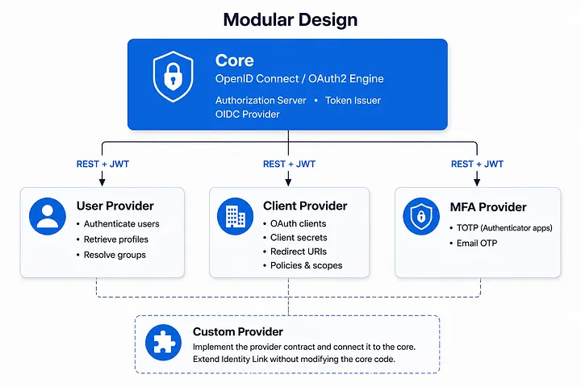
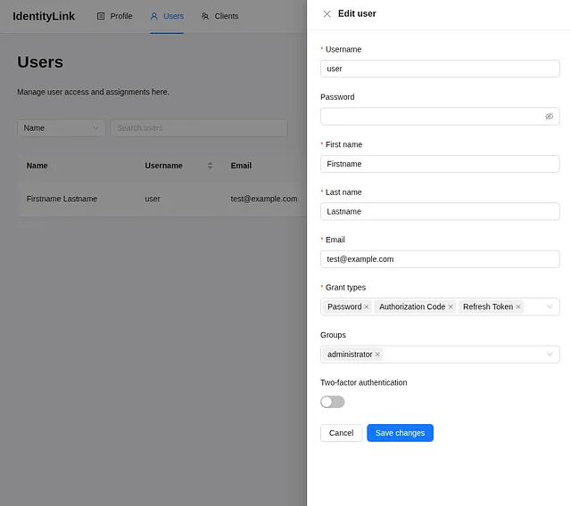
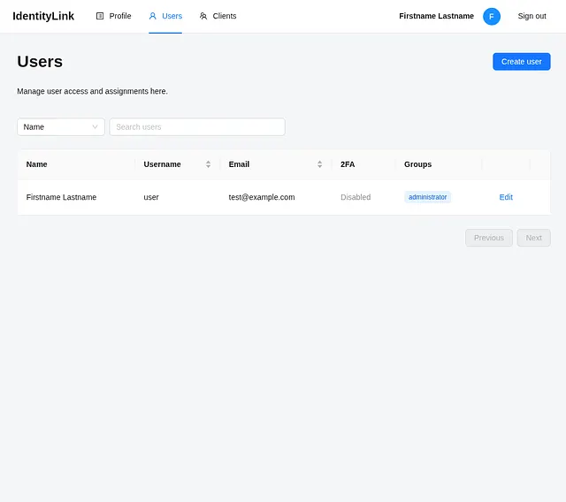
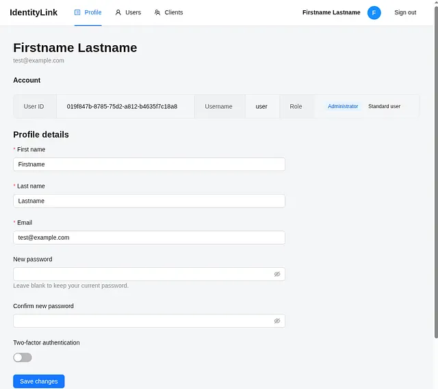
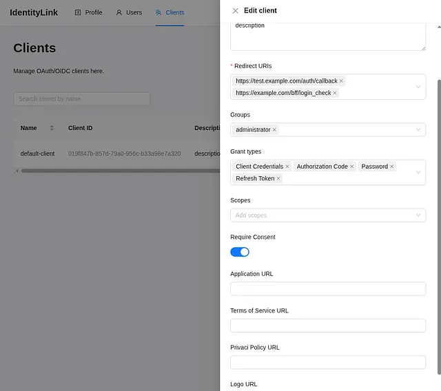
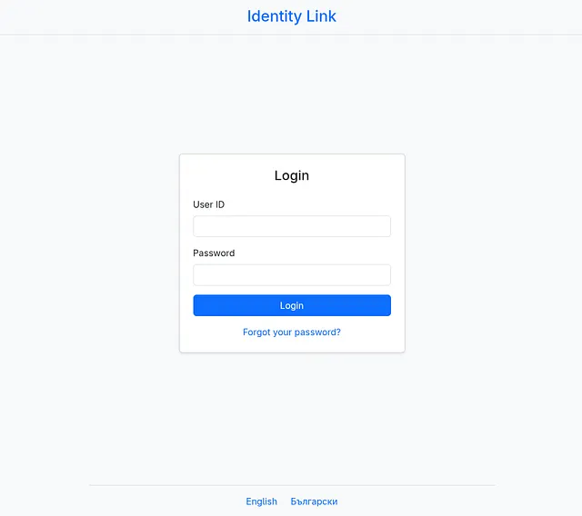
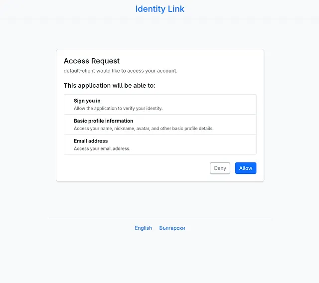
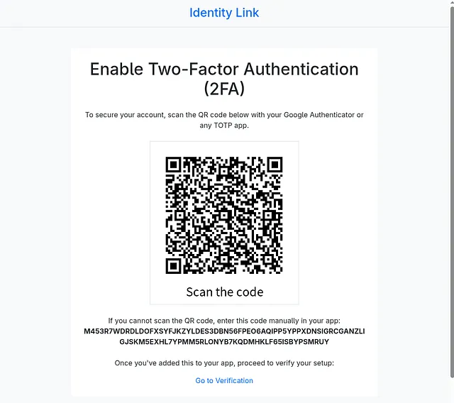
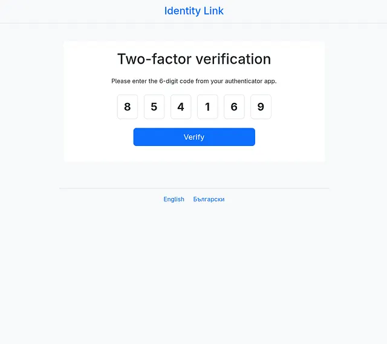

# Building Identity Link: Why I Designed a Modular OpenID Connect Identity Provider in Symfony

*Shifting the focus from user storage to seamless integration using PHP.*

## Every Company Already Has an Identity Story

When developers think about authentication, we usually think about protocols, data formats and different extensions — OAuth2, OpenID Connect, JWT, etc.

After working on different projects over the years, I realized that authentication isn’t really about protocols, it’s about integration.

One customer stored users in Microsoft Active Directory. Another relied on a twenty year old database that nobody wanted, or was even allowed to replace. Others exposed users through internal REST APIs or custom services that had evolved over many years. Every organization already had its own identity story.

> The problem wasn’t implementing OAuth2. The problem was integrating with what already existed.

That realization eventually became the foundation of Identity Link.

## Why Another Identity Provider?

It’s a fair question. There are already excellent identity platforms available today. Keycloak has become the open-source identity platform for many organizations and commercial offerings like Auth0 provide managed solutions.

I wasn’t trying to build something “better”. I was trying to build something different. I wanted to explore a simple architectural idea:

> What if the identity engine didn’t care where users, clients or authentication methods came from?

Instead of treating identity as a storage problem, what if we treated it as an integration problem? That single question influenced every architectural decision that followed.

## Meet Identity Link

[Identity Link](https://github.com/sgoranov/identity-link) is an open source OpenID Connect Identity Provider built with Symfony. It implements the OAuth2 and OpenID Connect protocols while intentionally keeping the authentication engine independent from the systems around it. Rather than tightly coupling authentication to a particular database or storage mechanism, Identity Link delegates those responsibilities to independent providers.

The goal isn’t to force organizations into a new identity model but to integrate with the one they already have.

For developers who want to evaluate the project quickly, I’ve also created a dedicated [Identity Link Docker Deployment](https://github.com/sgoranov/identity-link-docker) repository.

## The Core Should Know as Little as Possible

Most identity providers naturally accumulate responsibilities over time.

- They know how users are stored.
- They know where OAuth clients live.
- They implement multi-factor authentication.
- They own databases.
- They manage integrations.

Identity Link deliberately avoids that. The core has only one responsibility: Execute OAuth2 and OpenID Connect correctly. Everything else is delegated.

At the center of the platform is a small authentication engine responsible for authorization, token issuance and protocol compliance. Around it are interchangeable providers.

This separation allows the authentication engine to remain stable while everything around it can evolve independently.

## Users Are Just Another Provider

The first user provider stores users in a relational database. Nothing unusual there. The interesting part is that the authentication engine doesn’t actually know that. It simply asks a provider to authenticate a user. That provider could just as easily retrieve users from:

- Microsoft Active Directory
- LDAP
- Another REST service
- A legacy application
- A completely custom implementation

As long as the contract remains the same, the authentication flow never changes. That turned out to be one of the most satisfying design decisions in the project. Instead of forcing organizations to migrate their users, Identity Link adapts to existing infrastructure.

## Clients Deserve the Same Flexibility

The same philosophy applies to OAuth clients. Today they can be stored in a relational database. Tomorrow they could come from another service entirely. The authentication engine doesn’t care. Replacing storage should never require rewriting authentication logic.

## Multi-Factor Authentication Isn’t Special

Many identity providers tightly couple MFA into the authentication pipeline. I wanted to avoid treating it as something fundamentally different. Instead, MFA became another provider. Today Identity Link supports TOTP using applications like Google Authenticator.

Tomorrow it could support:

- Email verification
- SMS verification

without changing the authentication engine itself. The core simply asks one question:

> Does this user require another authentication step?

The provider decides.

## Building a Product, Not Just a Protocol

Implementing OpenID Connect is only half of the story. Real identity systems need administration. Users need to be managed. OAuth clients need configuration. Profiles need maintenance. Identity Link includes a dedicated administration console designed for day-to-day operations.

Users need to be managed.

Clients need configuration.

The goal wasn’t to build an OAuth2 library. It was to build a platform.

## Authentication Should Feel Simple

The architecture may be modular. The user experience shouldn’t be.

Authentication begins with a clean login experience. When required, users grant consent before applications receive access.

Organizations that require stronger authentication can enable TOTP.

Although these screens look straightforward, they’re backed by interchangeable providers that can evolve independently from the authentication engine itself.

## Getting Started Shouldn’t Take a Weekend

One lesson I’ve learned from open-source projects is that installation matters almost as much as architecture. Developers rarely evaluate software they can’t get running quickly. For that reason, Identity Link has its own Docker deployment project. Rather than manually assembling databases, services and configuration, the Docker deployment documents the entire production workflow — from TLS certificates and secret generation to tenant provisioning.

The goal is simple:

> Spend your time evaluating the architecture, not debugging the installation.

## Looking Forward

Identity Link isn’t trying to replace Keycloak. It doesn’t need to. Its goal is different.

To provide Symfony developers with a modern, modular OpenID Connect Identity Provider whose behavior can be extended by replacing providers rather than modifying the core.

The project is still evolving. Future work includes additional providers, stronger authentication mechanisms, broader integrations and continued improvements to the developer experience.

## Final Thoughts

OpenID Connect and OAuth2 are solved problems. Integration isn’t. Every company has different users. Different infrastructure. Different security requirements. Different constraints.

I believe an identity provider should embrace those differences instead of hiding them. That’s the philosophy behind Identity Link.

Whether you’re interested in the architecture, looking for a Symfony based identity platform, or simply curious about the project, I’d love to hear your thoughts.

- [Identity Link](https://github.com/sgoranov/identity-link)
- [Identity Link Docker](https://github.com/sgoranov/identity-link-docker)

If you have feedback, ideas, or would like to contribute, feel free to open an issue or start a discussion on GitHub.
