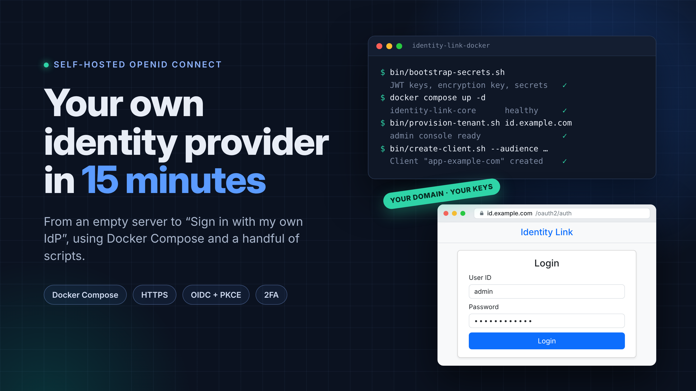
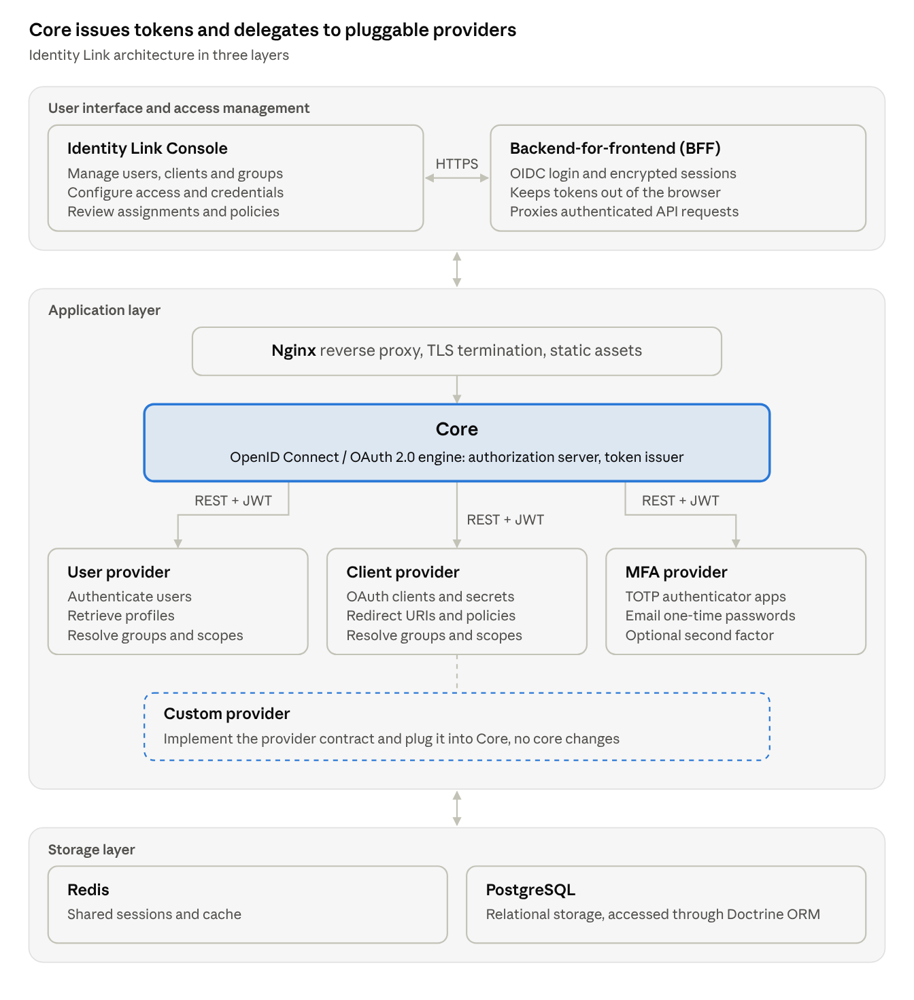

# Run Your Own OpenID Connect Identity Provider with Docker

*From an empty server to "Sign in with my own identity provider" in about 15 minutes, with Docker Compose and a handful of scripts.*



In my [previous article](https://medium.com/@simeon.goranov/building-identity-link-why-i-designed-a-modular-openid-connect-identity-provider-in-symfony-be79696f5475) I explained *why* I built Identity Link, a modular OpenID Connect identity provider written in Symfony. This one is about *how* you run it.

By the end of this guide you will have:

- a full Identity Link stack running on your own domain over HTTPS, with a real Let's Encrypt certificate;
- an admin console where you manage users, clients and groups;
- a standard OpenID Connect discovery endpoint that any OIDC library can consume;
- your first application registered and able to sign users in with the authorization code flow and PKCE.

Everything lives in one repository: [sgoranov/identity-link-docker](https://github.com/sgoranov/identity-link-docker). You never build anything yourself; the images are pulled from the GitHub Container Registry.

## What you're about to run

Identity Link isn't one big application. It's a set of small services, each with a single job, behind one nginx proxy:



At the centre is **Core**, the OpenID Connect and OAuth 2.0 engine: it runs the authorization server and issues tokens. Core doesn't store users or clients itself. It delegates to **providers** over REST, authenticated with JWTs: a user provider, a client provider and an MFA provider. Because they all implement the same provider contract, you can plug in a custom provider without touching Core.

On top sits the **admin console** and its **backend-for-frontend (BFF)**, which handles the OIDC login and keeps tokens out of the browser. In other words, the admin console is just another client of your identity provider, signing in through the same OIDC flow your own applications will use. Underneath, **PostgreSQL** holds the data and **Redis** holds shared sessions and cache.

## Before you start

You need four things:

- **A Linux server** with Docker and the Docker Compose plugin installed. A small VPS is enough to get started.
- **A domain name** whose DNS A record already points to that server. I'll use `id.example.com` in the examples; replace it with yours everywhere.
- **Ports 80 and 443 free.** Port 80 is used by Certbot to prove you own the domain, when it issues the certificate and at every renewal; the rest of the time the proxy listens on both.
- **Git**, to clone the repository.

Set up the DNS record first. Propagation is the one step that can take longer than the rest of this guide combined, and Certbot will fail until the domain resolves to your server.

## Step by step: the installation

### 1. Clone the repository

```bash
git clone https://github.com/sgoranov/identity-link-docker.git
cd identity-link-docker
```

### 2. Set your domain

The production configuration needs exactly one value: your domain name.

```bash
cp .env.example.prod .env
sed -i 's/^DOMAIN_NAME=.*/DOMAIN_NAME=id.example.com/' .env
```

Then point Docker Compose at the production overrides:

```bash
ln -rs docker-compose.prod.yml docker-compose.override.yml
```

Docker Compose loads `docker-compose.override.yml` automatically, so every command below works without `-f` flags. The production override is what wires in the secrets, the Let's Encrypt certificate, the hardened nginx config and a persistent volume for Postgres.

### 3. Get an HTTPS certificate

Identity Link only runs over HTTPS. Tokens and passwords should never travel in plain text, so there is no HTTP mode to fall back on. Certbot runs as a throwaway container, so you don't need to install it:

```bash
docker run --rm -it \
  -p 80:80 \
  -v "$PWD/config/letsencrypt:/etc/letsencrypt" \
  certbot/certbot certonly \
  --standalone \
  -d id.example.com \
  --email admin@example.com \
  --agree-tos \
  --no-eff-email
```

Link the certificate to where the proxy expects it:

```bash
ln -s "$PWD/config/letsencrypt/live/id.example.com/privkey.pem" config/certificates/server.key
ln -s "$PWD/config/letsencrypt/live/id.example.com/fullchain.pem" config/certificates/server.crt
```

### 4. Generate the secrets and keys

This is the step people usually get wrong when they self-host an identity provider, so I automated it completely:

```bash
/bin/bash bin/bootstrap-secrets.sh
```

The script starts a one-off `identity-link-core` container and uses its own console commands to generate:

- random credentials for the shared Postgres user;
- a separate application secret for each service (core, users, clients, 2FA, BFF);
- the encryption key used by the core service;
- the RSA key pair that signs your JWTs.

Each secret is written to its own file under `config/secrets` or `config/keys` and mounted into the containers as a Docker secret. That means no passwords in environment variables, and none in `docker inspect` output.

### 5. Start the stack

```bash
docker compose up -d
docker compose ps
```

The first run pulls the images and initialises Postgres. Wait until the services report `healthy` before moving on. The core, users, clients and 2FA services have health checks, and they only start once the database is ready.

### 6. Provision the first tenant

```bash
/bin/bash bin/provision-tenant.sh id.example.com
```

This creates everything the admin console needs to log you in:

- an `administrator` group with the OpenID Connect scopes plus the `identity-link.all` management scope;
- the `bff-client` that the admin console's backend uses to authenticate. Its client ID and secret are saved straight into `config/secrets`, so you never copy them by hand;
- an `admin` user in the `administrator` group, with a random password that the script prints once at the end.

That's the installation. Everything from here on is configuration.

## Log in to the admin console

Open `https://id.example.com/admin-console`. You're redirected to the Identity Link login page, which is the console using its own identity provider to sign you in.

Sign in as `admin` with the password that `provision-tenant.sh` printed at the end of step 6:

```txt
Administrator "admin" was created.

  Username:  admin
  Password:  <generated password>
```

**Save that password in a password manager before you continue.** The script generates it randomly, shows it only once and doesn't store it anywhere else. If you lose it, generate a new one:

```bash
docker compose exec identity-link-db-users php bin/console app:reset-user-password --username admin
```

From the console you can manage:

- **Users**, including group membership and password resets;
- **Clients**, the applications allowed to request tokens, with their secrets and redirect URIs;
- **Groups**, which grant scopes to users and clients for a given audience.

Two more security features are ready to use. Users who turn on **two-factor authentication** in their profile are asked for the second factor at every login. And a **consent screen**, which shows users which application is asking for what, can be turned on for each client with **Require Consent** in the admin console.

## Sign users in to your first application

An identity provider is only useful once something trusts it. Let's register an application and sign a user in.

### Check the discovery document

```bash
curl -s https://id.example.com/.well-known/openid-configuration | jq
```

`jq` only formats the output; leave it out if it isn't installed.

Among other things, you'll see the endpoints your application will use:

| Endpoint | URL |
| --- | --- |
| Authorization | `https://id.example.com/oauth2/auth` |
| Token | `https://id.example.com/oauth2/token` |
| UserInfo | `https://id.example.com/user-info` |
| JWKS (signing keys) | `https://id.example.com/jwks` |
| Introspection | `https://id.example.com/oauth2/token/introspect` |

Most OIDC libraries only need the issuer and work out everything else from it.

### Register the application

```bash
/bin/bash bin/create-client.sh \
  --audience https://app.example.com \
  --redirect-uri https://app.example.com/callback
```

One command does three things:

1. It declares `https://app.example.com` as an audience, in `config/authorization/client-app-example-com.yaml`. Before it touches anything, it validates the authorization configuration, and it removes the file again if the result would be invalid.
2. It creates a group `app-example-com` that grants the OpenID Connect scopes for that audience.
3. It creates the client with the `authorization_code` and `refresh_token` grant types and prints its client ID and secret.

**Copy the secret now.** It's shown only once. Repeat `--redirect-uri` if the application has several callbacks.

### Configure your application

Whatever framework you use, the settings are the same:

- **Issuer:** `https://id.example.com/identity-link`. Most libraries need only this: they find the discovery document under it, at `https://id.example.com/identity-link/.well-known/openid-configuration`.
- **Discovery URL:** `https://id.example.com/.well-known/openid-configuration`, for libraries that ask for it instead.
- **Client ID and secret:** from the output above
- **Redirect URI:** `https://app.example.com/callback`
- **Scopes:** `openid profile email`, plus `offline_access` if you want refresh tokens
- **Client authentication:** `client_secret_basic` (HTTP Basic auth at the token endpoint). It's the only method the discovery document advertises, so set it explicitly if your library defaults to something else.
- **PKCE:** enable it with `S256`. Identity Link verifies the code verifier, and a wrong one is rejected with `invalid_grant`.

Don't give your library just the domain: the issuer is `https://id.example.com/identity-link`, and libraries reject a discovery document whose issuer differs from the one they were given.

### What happens when a user signs in

1. Your application redirects the browser to `/oauth2/auth` with `response_type=code`, the client ID, redirect URI, scopes, a `state` and a PKCE `code_challenge`.
2. The user logs in on the Identity Link page, completes the second factor if one is required, and approves the consent screen if the client requires consent.
3. Identity Link redirects back to your callback with a `code` and the same `state`.
4. Your backend posts the code and the `code_verifier` to `/oauth2/token`, authenticated with the client ID and secret.
5. It receives an access token, an ID token signed with the key published at `/jwks`, and a refresh token if you asked for `offline_access`.
6. Calling `/user-info` with the access token returns the user's claims: `sub`, `email` and the profile fields.

This exact flow is covered by the repository's Playwright end-to-end tests, so it's tested code, not just documentation.

## Day-2 operations

A few commands cover most of what you'll do after launch.

**Logs.** Follow everything live:

```bash
docker compose logs -f
```

The stack also includes a Vector container that collects every service's logs into dated files under `./logs`, and a small retention job that deletes files older than seven days.

**Updates.** Each release of the repository pins the Identity Link images, so update the checkout first, then pull the images and recreate the containers:

```bash
git pull
docker compose pull
docker compose up -d --force-recreate
```

`--force-recreate` also recreates the containers whose image didn't change, so the proxy and Vector pick up their updated configuration files.

**Certificate renewal.** Let's Encrypt certificates expire after 90 days. Renewal needs port 80, so stop the proxy for a moment:

```bash
docker compose stop identity-link-proxy
docker run --rm -p 80:80 \
  -v "$PWD/config/letsencrypt:/etc/letsencrypt" \
  certbot/certbot renew --no-random-sleep-on-renew
docker compose start identity-link-proxy
```

Put these three commands in a script and run it from cron once a week. Certbot only renews when the certificate is close to expiry, so frequent runs are harmless, though each one stops the proxy for a few seconds. `--no-random-sleep-on-renew` keeps that short: without it, Certbot waits up to 8 minutes before renewing when it runs without a terminal, as under cron. To confirm the proxy is serving the new certificate:

```bash
echo | openssl s_client -connect id.example.com:443 -servername id.example.com 2>/dev/null \
  | openssl x509 -noout -enddate
```

**A locked-out user.** Reset a password from the command line:

```bash
/bin/bash bin/reset-user-password.sh <username>
```

**Backups.** Your state lives in two places: the `identity-link_postgres_data` Docker volume, and the `config/` directory, which holds the secrets, signing keys, certificates and authorization files. Back up both. If you lose the JWT keys, every token you've issued becomes unverifiable; if you lose the encryption key, every refresh token stops working and users have to sign in again.

## Wrapping up

In six steps you went from an empty server to a working OpenID Connect provider: generated keys, HTTPS, an admin console, and an application signing users in with PKCE. You own every part of it: the user database, the signing keys and the login page.

If you try it, I'd love to hear how it went:

- the Docker setup: [github.com/sgoranov/identity-link-docker](https://github.com/sgoranov/identity-link-docker)
- the core server: [github.com/sgoranov/identity-link](https://github.com/sgoranov/identity-link)
- the design story: [Building Identity Link: why I designed a modular OpenID Connect identity provider in Symfony](https://medium.com/@simeon.goranov/building-identity-link-why-i-designed-a-modular-openid-connect-identity-provider-in-symfony-be79696f5475)

Issues, stars and pull requests are all welcome. If something in this guide didn't work for you, open an issue and I'll fix the guide.
